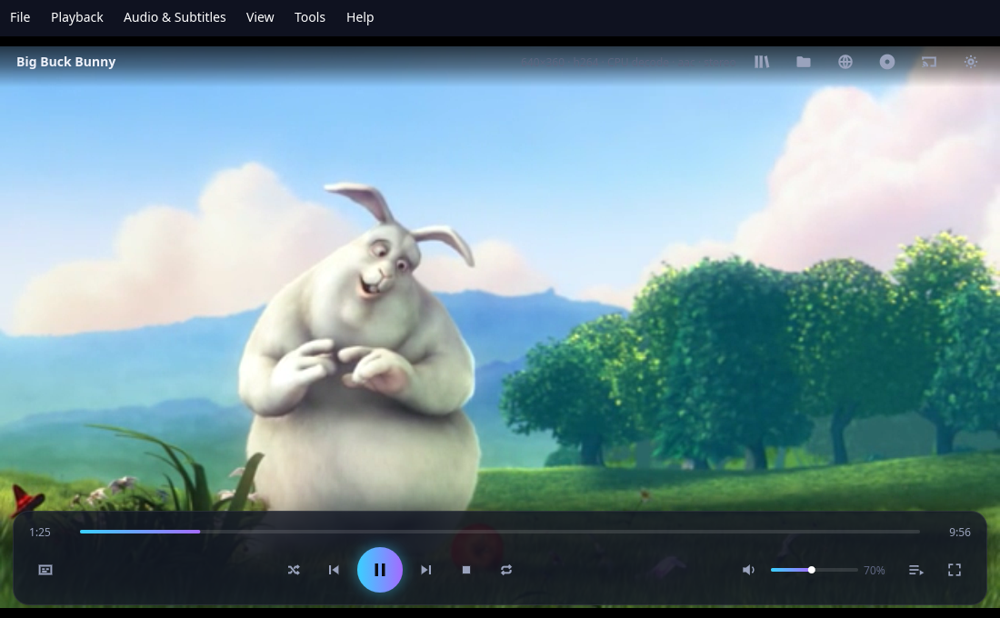
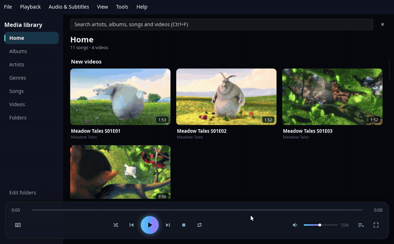
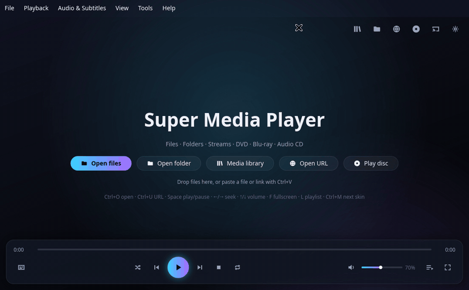
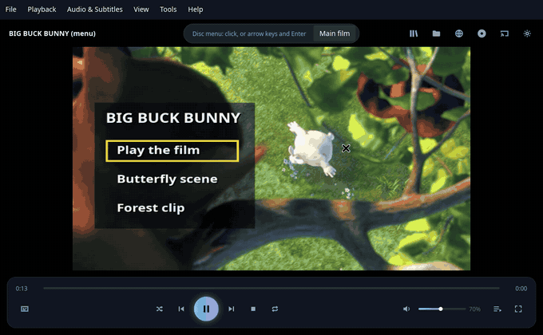
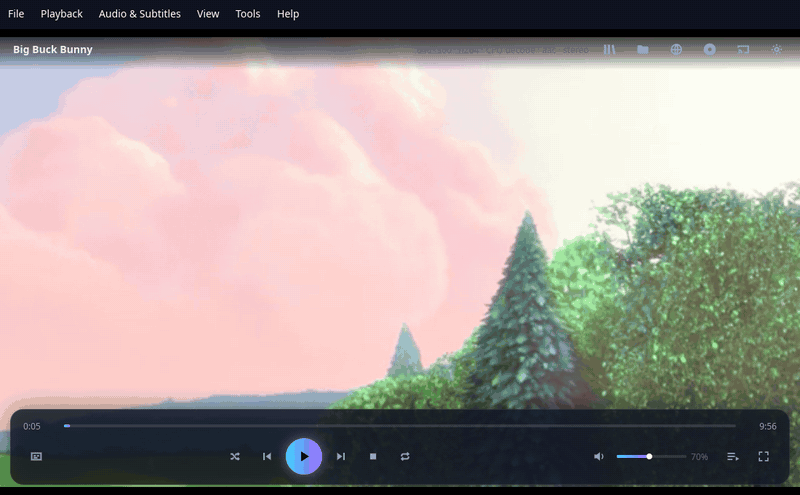
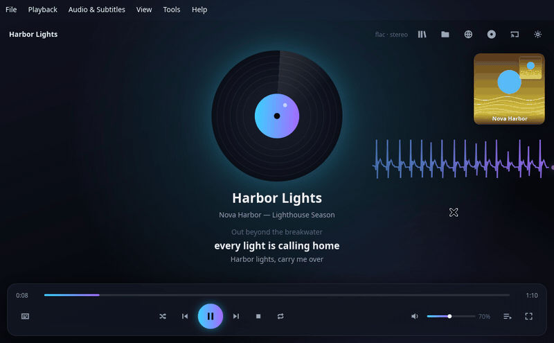
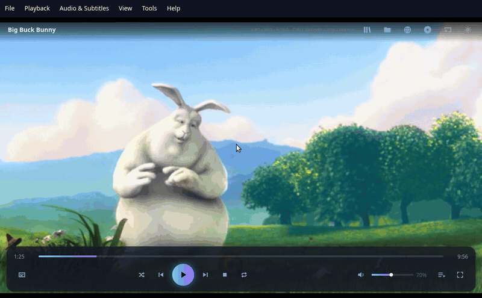
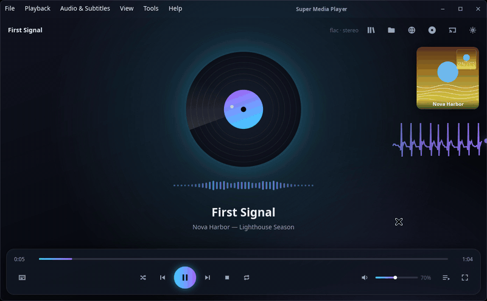
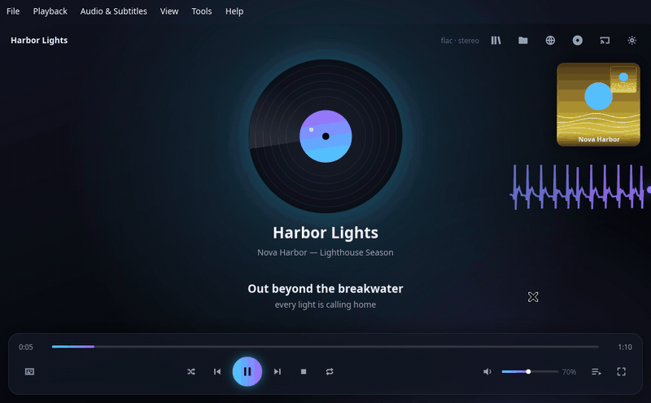

# Super Media Player (SMP)

A fast media player for Linux that plays almost anything: files, folders, internet
radio, podcasts, network shares, YouTube and similar sites, **audio CDs, DVDs (with
their menus) and Blu-rays**. It can also send what you play to a TV.



**[→ Read the step-by-step user guide](docs/guide/README.md)**

## What it does

| | |
|---|---|
|  | **[Media library](docs/guide/media-library.md)**: your music and videos as albums, artists, songs and series, with *Continue watching* and instant search. |
|  | **[Internet radio and podcasts](docs/guide/radio-and-podcasts.md)**: search about 50,000 stations, save your favourites, record them. |
|  | **[Discs](docs/guide/discs.md)**: DVDs with their own menus, Blu-rays, audio CDs with song names and covers, and ripping CDs to FLAC. |
|  | **[Casting](docs/guide/casting.md)**: send a film or song to a Chromecast, a smart TV or a network speaker. |
|  | **[Music](docs/guide/music.md)**: timed lyrics, a beat line, MilkDrop visuals, equalizer, karaoke, gapless and bit-perfect playback. |
|  | **[Video](docs/guide/video-and-subtitles.md)**: preview pictures on the seek bar, subtitles from speech, subtitles lined up with the speech, skip intros and YouTube sponsors, sharpening and upscaling. |
|  | **[Skins](docs/guide/looks-and-skins.md)**: a full player, a compact one and two classic decks, in many colours. You can make your own. |
|  | **[Command palette](docs/guide/getting-started.md#find-anything-the-command-palette)**: press Ctrl+K and type a few letters of anything. |

And more: [network shares and NAS](docs/guide/network.md),
[phone remote and watching together](docs/guide/phone-remote-and-watch-together.md),
[frame-by-frame navigation](docs/guide/playing.md#frame-by-frame-advanced-navigation),
[saving clips and GIFs](docs/guide/video-and-subtitles.md#save-a-clip-or-convert),
[scripts made for mpv](docs/guide/settings.md#mpv-scripts).

## Install

Super Media Player comes as a package with everything inside (FFmpeg, codecs, yt-dlp).
Linux on a 64-bit PC; Windows, macOS and Android are planned.

**Ubuntu, Debian, Mint**

```sh
sudo apt install ./super-media-player_<version>_amd64.deb
```

**Any other distribution**, or without administrator rights:

```sh
tar xf super-media-player-<version>-linux-x86_64.tar.gz
cd super-media-player-<version>-linux-x86_64
./install.sh                # adds it to your applications menu
./install.sh --uninstall    # removes it again
```

Then start **Super Media Player** from your applications menu, and continue with
[Getting started](docs/guide/getting-started.md).

## Is something wrong?

*Tools → Setup & updates → System check* looks for missing pieces and says how to fix
each one. See also [Troubleshooting](docs/guide/troubleshooting.md).

## Your privacy

The player has no account, no ads and collects nothing. It goes online only for things
you use: streams, searches, the lookups listed in
[Settings and privacy](docs/guide/settings.md#what-goes-online), and checking for a newer
yt-dlp.

## For developers

[Building and developing](docs/BUILDING.md) · [Making skins](SKINS.md) · [Roadmap](PLAN.md)

## License

GPL-3.0-or-later (required by the GPL parts of mpv and FFmpeg we ship).

The pictures in this guide show *Big Buck Bunny* © 2008 Blender Foundation
([peach.blender.org](https://peach.blender.org)), CC BY 3.0, and invented music.
