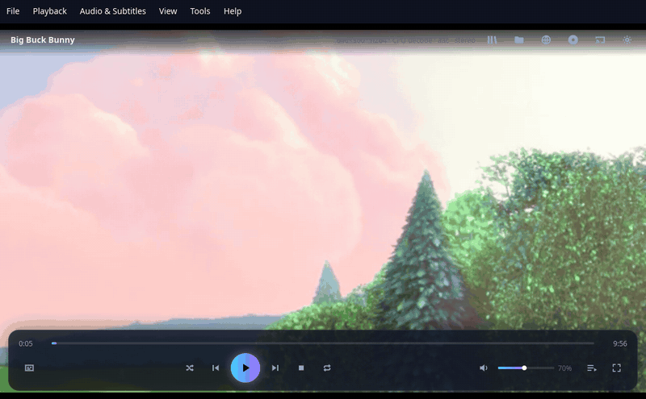
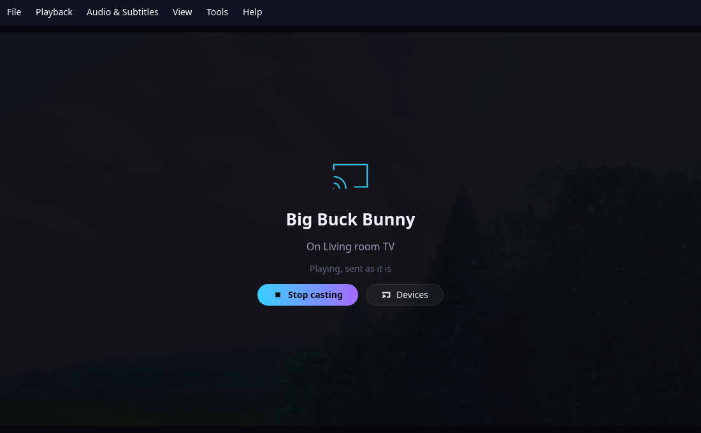
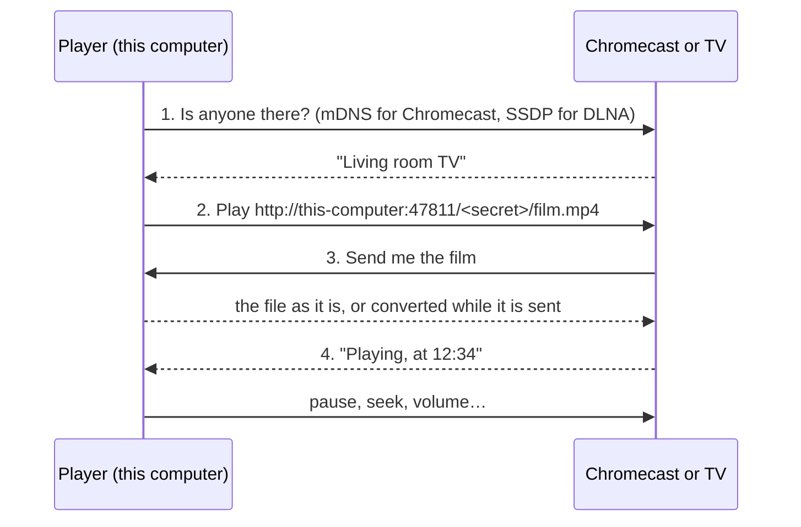

# Casting: watch on your TV, listen on a speaker

[← Guide](README.md)

Send what you play to a **Chromecast** (or a TV or speaker with Chromecast built in), a
**DLNA** smart TV (Samsung, LG, Sony, Panasonic…), or a network speaker.

## How to

1. Turn the device on. It must be on the **same network** as this computer.
2. Open a film or song.
3. Press the **screen icon** at the top right (or *Tools → Cast to a TV or speaker…*).
4. Wait a few seconds and click your device.

Now the film plays on the TV and the player is its **remote control**:

- Play, pause, seek, volume and mute work as always: buttons, keyboard, media keys, and
  the [phone remote](phone-remote-and-watch-together.md).
- The playlist goes on by itself: the next item plays on the TV.
- Open another file, and it goes to the TV too.
- **Stop casting** brings the film back here, paused at the same place.

Keep the player open while casting; it is where the TV gets the film from.

## How it works

1. **Finding devices.** The player asks on your network who can play media.
2. **Starting.** It opens a small web server on this computer and tells the device its
   address. Nothing goes over the internet to reach the TV, and no Google account is
   needed. (A Chromecast itself does load its standard player from Google.)
3. **Sending.** The device fetches the film from this computer. A Chromecast or TV only
   understands some formats, so the player decides per file:

   | Your file | What is sent |
   |---|---|
   | The TV can play it | The file as it is: best quality, no work for your computer |
   | Only the sound or the container is a problem (DTS, AC-3, MKV…) | The picture untouched, the rest converted on the fly |
   | The picture is a problem | Converted to H.264 while it is sent |
   | The TV refuses it | Sent again, converted |

4. **Controlling.** The device reports where it is; your buttons are passed on to it.

**Privacy:** the server runs only while casting, serves only the file being cast, and its
address contains a long random secret.

## Options

At the bottom of the cast window:

- **Convert only what it can't play** (the normal choice), **Always send as it is**, or
  **Always convert (H.264)** for a TV that stutters.
- **Subtitles drawn into the picture**: if your TV doesn't show them. Otherwise text
  subtitles are sent along, and picture subtitles (from discs) are always drawn in.

## If it doesn't work

| Problem | Try |
|---|---|
| The device isn't listed | Is it on, and on the same network? Guest Wi-Fi separates devices. Otherwise type its address at the bottom and press **Add** |
| It is listed, but nothing plays | A firewall: allow incoming TCP port **47811** from your network (Ubuntu: `sudo ufw allow from 192.168.0.0/16 to any port 47811 proto tcp`) |
| It stutters | Use a cable or 5 GHz Wi-Fi; if the status says "converted", try **Always send as it is** |
| Wrong or no sound | Choose another audio track in the player |
| Seeking jumps a little | When only the sound is converted, it can start at key pictures only |

Installing the `ffmpeg` program (`sudo apt install ffmpeg`) lets the player leave the
picture untouched in more cases. It works without, but then converts everything it can't
send as it is.

**Can't be cast:** discs (copy them to a file first). Playback speed and frame steps don't
work while casting.
