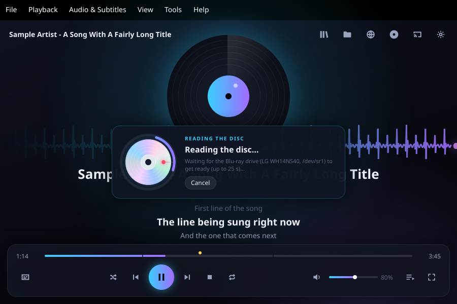
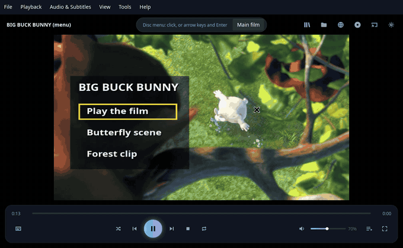
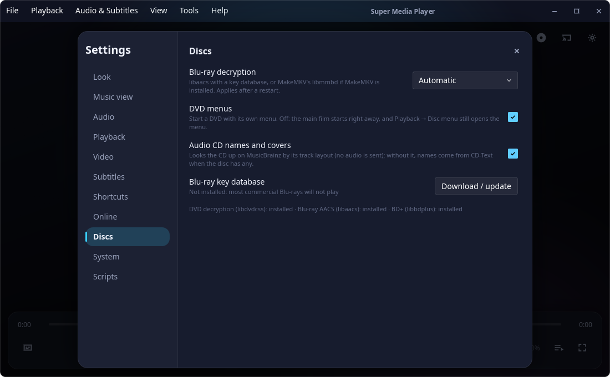
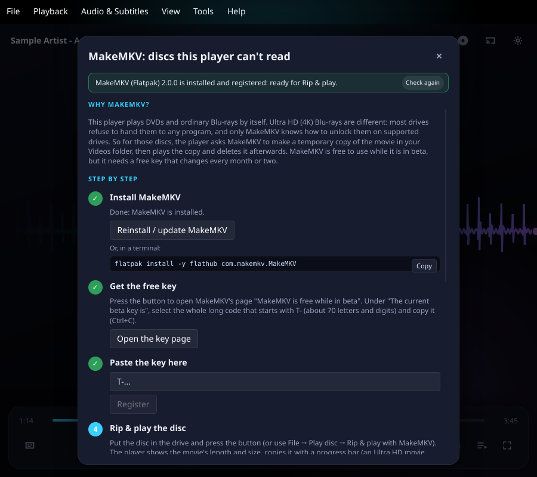
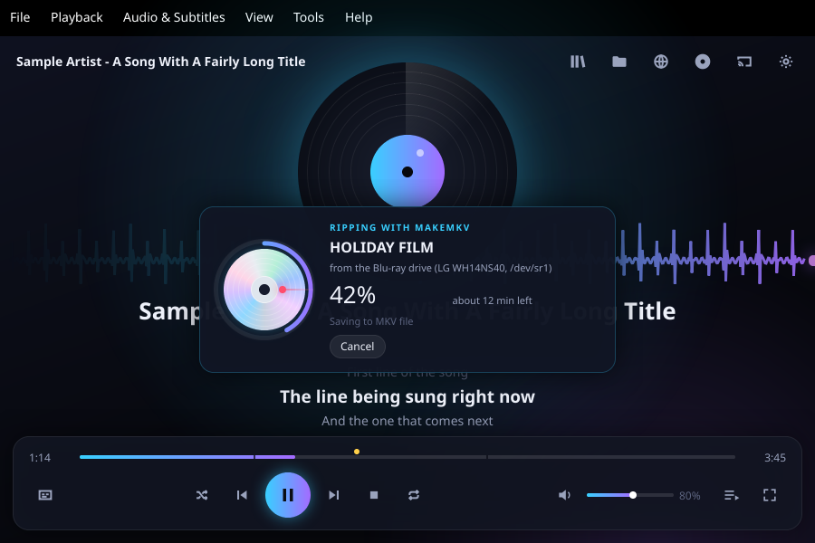

# Discs: CD, DVD and Blu-ray

[← Guide](README.md)

Put the disc in and press **Ctrl+D** (or *File → Play disc → Detect disc in drive*, or the
disc icon at the top right). The player looks at what the disc really is and plays it.
With discs in two drives, it asks which one. A drive that is still spinning up can take
up to half a minute; the card shows what it is doing, and **Cancel** stops it.

| Disc | Plays | Menus | Needs |
|---|---|---|---|
| Audio CD | yes | – | nothing |
| DVD | yes | yes | nothing (libdvdcss is in the packages) |
| Blu-ray | yes, main film | no | a key database, for copy-protected discs |
| Ultra HD Blu-ray (4K) | through MakeMKV | no | a suitable drive, and MakeMKV |

Whether decrypting discs you own is allowed depends on your country.

## DVDs, with their menus

The disc starts as on a DVD player: logos first, then its menu.

- **Choose** with the mouse, or with the arrow keys and Enter.
- **Skip** a logo or warning with the **Skip** button or N.
- **Straight to the film:** press **Main film** at the top. *File → Play disc → DVD, main
  film (no menu)* does so from the start.
- **Back to the menu** while the film plays: *Playback → Disc menu* (**Ctrl+Shift+D**). Then
  **Back to the film** (or Esc) continues where you left it.
- When a film or episode ends, the disc goes on by itself, usually to its menu.

The film itself plays like any other: seeking, chapters (PgUp / PgDn), sound and subtitle
tracks (the button at the far left of the control bar).

Don't like menus? Turn them off in *Settings → Discs → DVD menus*; *Playback → Disc menu*
still opens them.

## Audio CDs

Song names, artist and cover are looked up at MusicBrainz by the disc's track layout
(no sound is sent). Without internet, names come from the disc's own CD-Text if it has
any. *Settings → Discs → Audio CD names and covers* turns the lookup off.

### Copy a CD to FLAC files

1. *File → Play disc → Rip audio CD to FLAC…*
2. Check the folder it suggests and confirm.
3. The songs go to `Music/Artist/Album`, with names, tags and the cover. Reading is
   checked for errors (cdparanoia), so a CD takes several minutes.

## Blu-rays

Blu-rays play their main film. Their menus are not supported.

Copy-protected discs need a key database, once: *Tools → Setup & updates → Download
Blu-ray key database*. It is refreshed monthly by itself.

If a disc isn't in the database, use MakeMKV (below), or set *Settings → Discs → Blu-ray
decryption* to MakeMKV.

## Ultra HD Blu-ray, and discs that won't play: MakeMKV

Most drives refuse to hand 4K discs to any program but
[MakeMKV](https://www.makemkv.com), on drives it supports.

1. *Tools → Setup & updates → MakeMKV (key & help)…* and follow its three steps: install
   it, get the free key, paste the key.

   

2. *File → Play disc → Rip & play with MakeMKV…*
3. It copies the film (a 4K film takes 20 to 60 minutes) and then plays it. The copy is
   temporary and deleted afterwards.

## Disc images and folders

*File → Play disc → Disc image (ISO)…* or *Disc folder (VIDEO_TS / BDMV)…*. DVD images have
their menus too.
