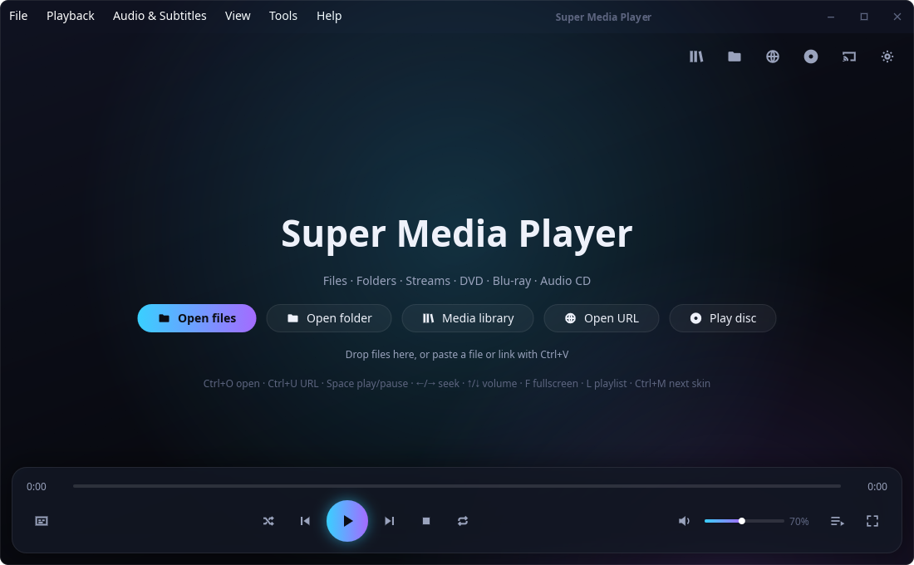
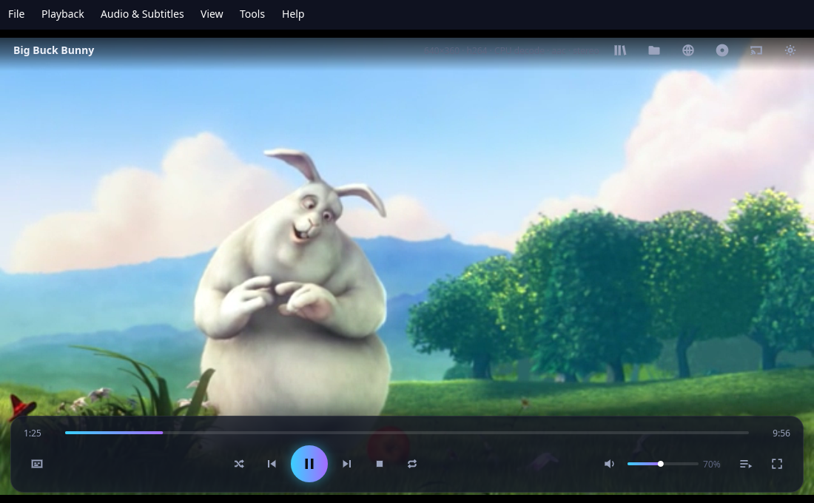
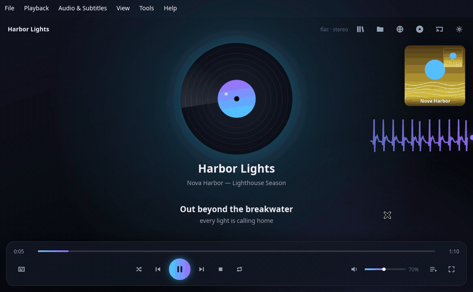

# Getting started

[← Guide](README.md)

## 1. Install

**Ubuntu, Debian, Mint.** Open a terminal in the folder with the downloaded file:

```sh
sudo apt install ./super-media-player_<version>_amd64.deb
```

**Any other distribution.** Unpack the `.tar.gz` file and run `./install.sh` inside. It
needs no administrator rights and adds the player to your applications menu.

Nothing else is needed: the codecs are inside.

## 2. The window



- **Menu bar** (top): everything the player can do. The empty part on its right is the
  title bar: drag it to move the window, double-click to maximize, right-click for the
  window menu. *Settings → Look → Title bar* brings the desktop's own bar back.
- **Icons** (top right), from left to right: media library, open files, open a link,
  play a disc, cast to a TV, settings.
- **Control bar** (bottom): the seek bar, then audio and subtitle tracks (far left),
  shuffle, previous, play/pause, next, stop, repeat, volume, playlist and fullscreen.

While a video plays, the bars hide by themselves. Move the mouse to bring them back.

## 3. Play something

Pick whichever suits you:

- Press **Open files** (Ctrl+O) or **Open folder** (Ctrl+Shift+O).
- Copy a file, folder or link anywhere, then press **Ctrl+V** in the player.
- Double-click a file in your file manager, once the player is the default app for it.
- Drag files onto the window. On a Wayland desktop this needs *Settings → System →
  Window system → X11 (drag and drop)*. On Windows it doesn't work while the player
  runs as administrator. Ctrl+V works everywhere.



The five keys worth knowing:

| Key | What it does |
|---|---|
| Space | Play or pause |
| ← → | Back or forward 5 seconds (with Shift: 30) |
| ↑ ↓ | Volume |
| F | Fullscreen (Esc leaves it) |
| Ctrl+K | Find anything (see below) |

## Find anything: the command palette

You don't have to remember where things are. Press **Ctrl+K**, type a few letters
("equal", "radio", "sleep", a song in the playlist) and press Enter.



Next: [Playing files](playing.md) · [Media library](media-library.md) ·
[Discs](discs.md)
