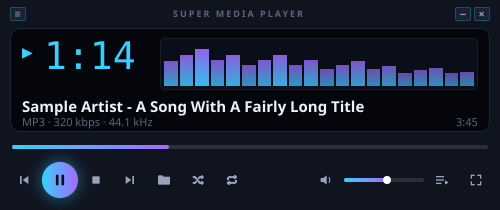
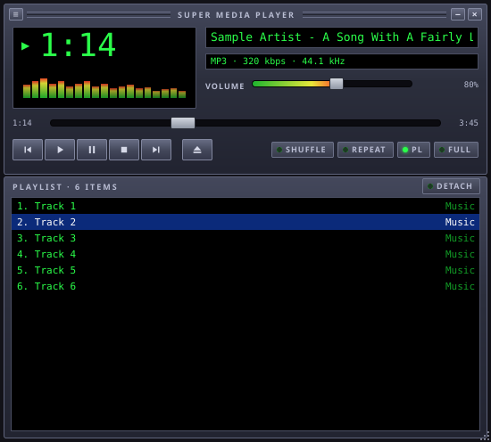
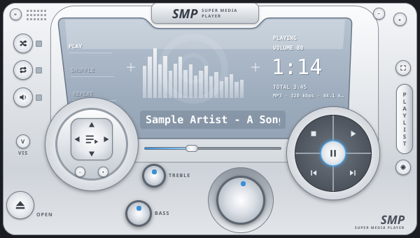
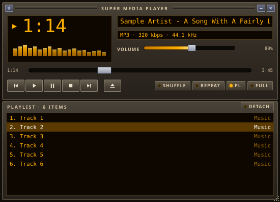

# Looks and skins

[← Guide](README.md)

Press **Ctrl+M** for the next skin, or choose one in *View → Skin*.

| Compact | Classic deck | Silver deck |
|---|---|---|
|  |  |  |

Each comes in several colours:

| Midnight | Amber | Rose gold |
|---|---|---|
|  |  |  |

In a small skin, right-click anywhere for the full menu.

## Make your own

A skin is a small text file with colours. *View → Skin → Open skins folder* opens the
folder, with examples to start from; *Reload skins* shows your changes at once. Details:
[Making skins](../../SKINS.md).
