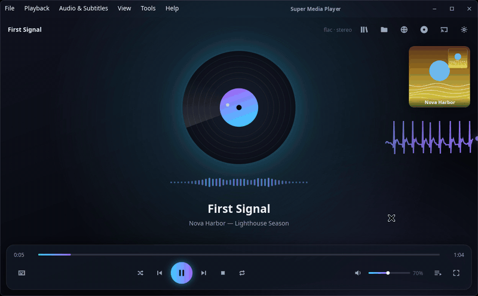
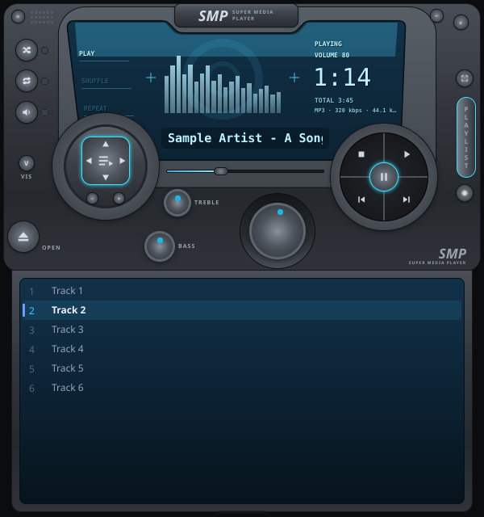
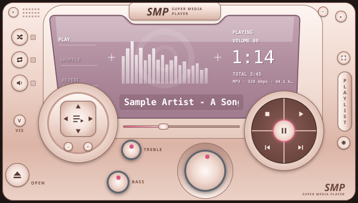
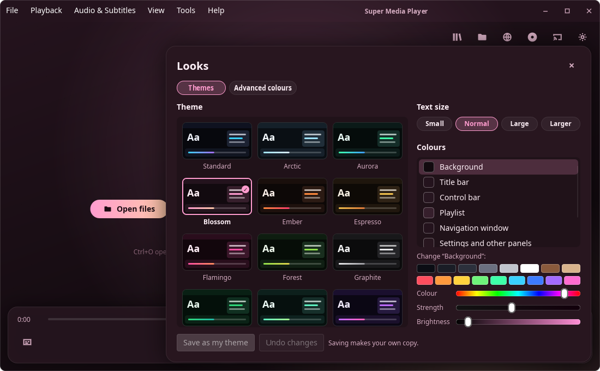
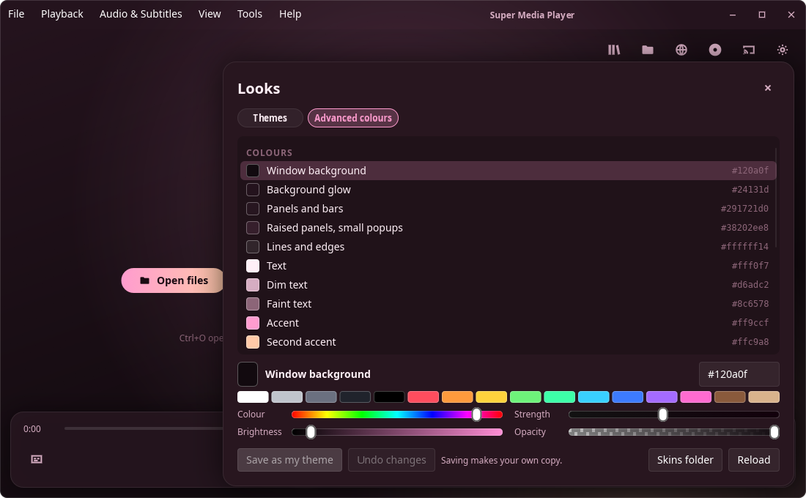

# Looks and skins

[← Guide](README.md)

Press **Ctrl+M** for the next skin, or choose one in *View → Skin*. In a small skin
the menu is *Skin…*: it opens the list of skins, which scrolls.

| Compact | Classic deck | Silver deck |
|---|---|---|
|  |  |  |

Each comes in several colours:

| Midnight | Amber | Rose gold |
|---|---|---|
|  |  |  |

In a small skin, right-click anywhere for the full menu.

In the Classic and Silver decks, rest the pointer on a button or knob for two
seconds to see what it does, for example "Shuffle off" or "80% volume".

The Classic deck opens with its playlist showing. If you hide it, it stays hidden
next time.

In the Classic and Silver decks, the playlist can have a window of its own: click
**DETACH** on the playlist (or double-click its title). Put the window anywhere.
**DOCK** puts the playlist back under the deck.

## Themes, text size and colours

*View → Themes and colours…* (or *Settings → Look → Themes and colours…*) opens the
**Looks** panel.

- **Theme**: click a picture to use that theme. Each one colours the whole player:
  the background, title bar, control bar, playlist and dialogs. Themes are kept
  apart from skins: they are only here, not in *View → Skin*. Your theme stays on
  in the media player and the compact view, and comes back when you return from
  a deck. In the Classic and Silver decks, the pictures are the deck's own colours.
- **Text size**: Small, Normal, Large or Larger. It changes the text of the media
  player and its dialogs. The small skins keep their own text size.
- **Colours**: click a part (Background, Title bar, Control bar, Playlist,
  Navigation window, Settings and other panels, Text, Highlight), then click a
  small colour square or move the bars. Related shades follow along: when you
  change the text, the dimmer text changes with it.

You see each change at once. Click **Save as my theme** to keep it. Saving makes
your own copy ("My …"), so the built-in themes stay as they are. When you change
your own copy, **Save** writes into it. **Undo changes**, or closing without saving,
puts the colours back.

### Advanced colours

The **Advanced colours** tab lists every colour of the view you use, for those who
like to fine-tune: buttons under the pointer, faint text, each part of the decks.

1. Click a colour in the list.
2. Change it with the bars, click one of the small colour squares, or type a code
   such as `#ff8a3d` and press Enter.

In a small skin the window grows downwards while the panel is open, so the deck
stays in view.

The menus themselves keep Slint's dark style: their colours can't be changed yet.

## Move dialogs around

Drag a dialog (settings, library, about…) by its title or any empty spot to move it.
It stays inside the player's window. Double-click an empty spot to put it back.

## Make your own skin file

A skin is a small text file with colours. *View → Skin → Open skins folder* opens the
folder, with examples to start from; *Reload skins* shows your changes at once. Details:
[Making skins](../../SKINS.md).
