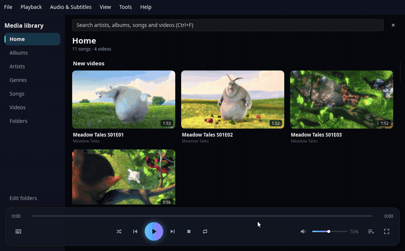

# Media library

[← Guide](README.md)

All your music and videos in one place. Open it with the first icon at the top right,
*File → Library → Media library*, or **Ctrl+Shift+M**.

## Set it up (once)

1. Press **Add my Music and Videos folders**, or **Choose a folder…**.
2. Wait a moment while it reads the files. You can already browse.

Your files stay where they are and are never changed. The library looks for new files
each time it opens; *Edit folders* adds or removes folders later.

## Use it

- **Home**: what you started and didn't finish (*Continue watching*), and what is new.
- **Albums, Artists, Genres, Songs, Videos, Folders**: click to open, then **Play**,
  **Shuffle** or **Add** (to the playlist).
- **Search** (Ctrl+F) looks through everything as you type, and ignores accents: "senorita"
  finds "Señorita".
- **Esc** goes back, then closes the library.

Music keeps playing while you browse.

## Good to know

- Files without tags get their artist and title from names like `Artist - Title.mp3`.
- A cover is taken from the file itself, or `cover.jpg` / `folder.jpg` beside it.
- A drive that is unplugged keeps its entries, and plays again when it's back.

**Media library or Library?** The *media library* is what is on your disks. The
*Library* panel ([radio, podcasts](radio-and-podcasts.md), [network](network.md), saved
links) is what is elsewhere.
