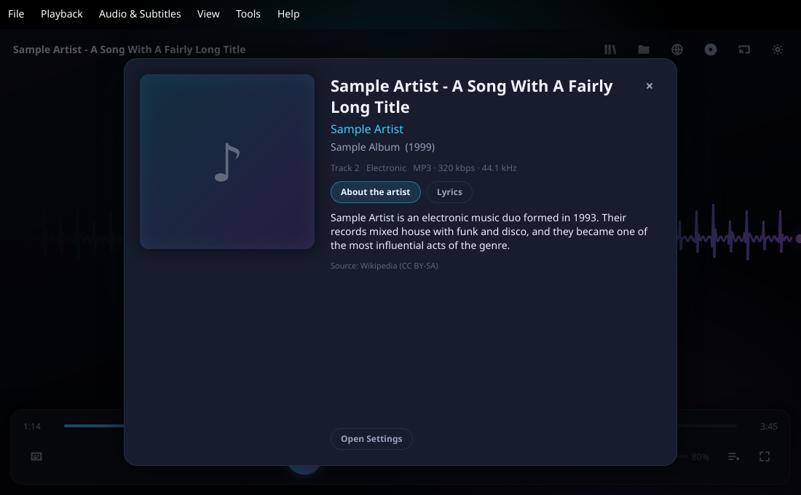
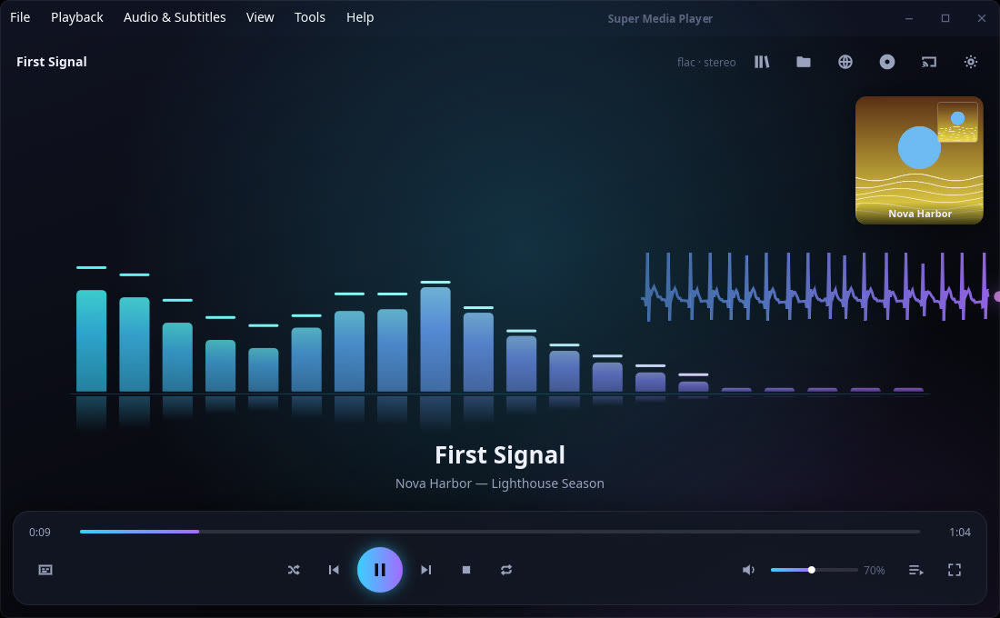
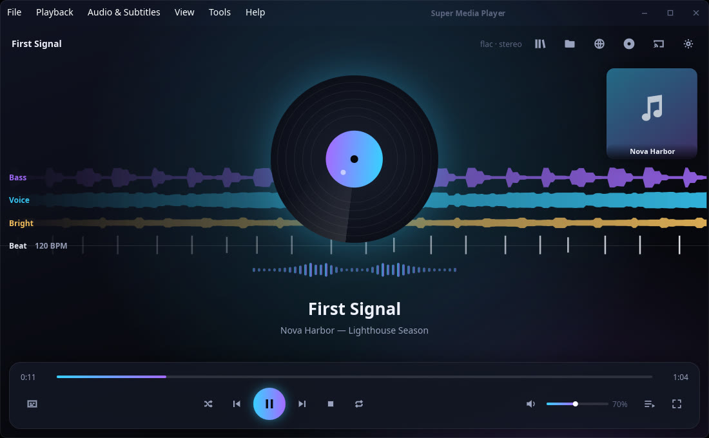
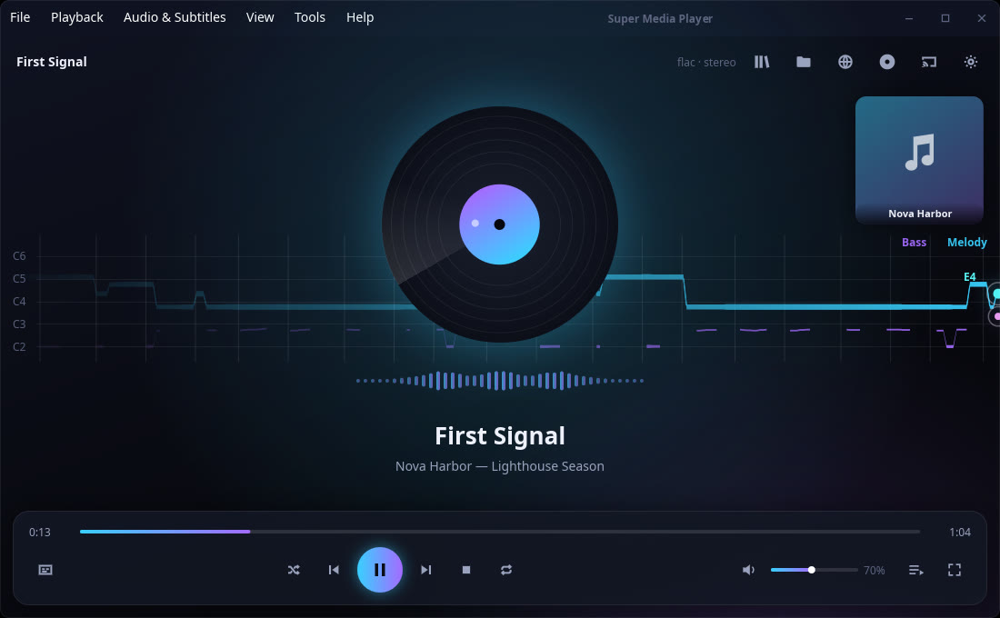
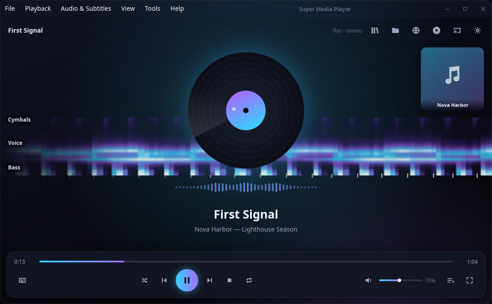
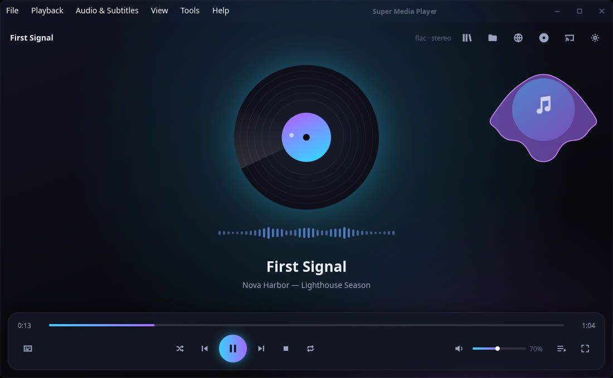
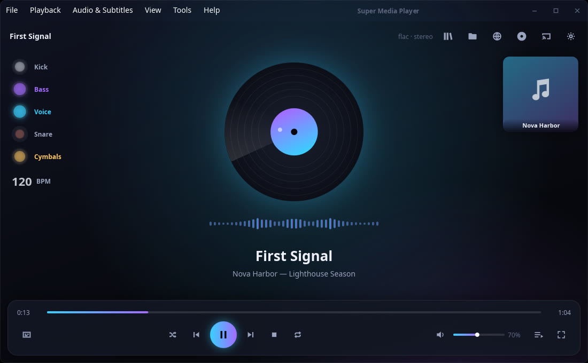
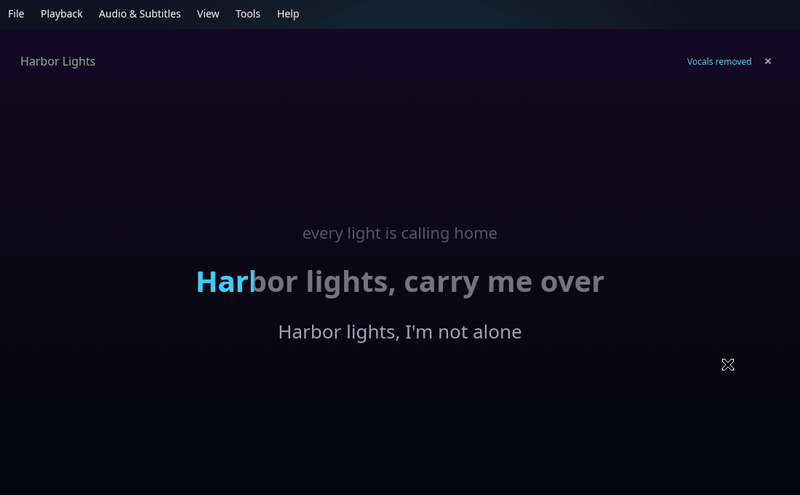

# Music

[← Guide](README.md)

## Lyrics

Timed lyrics scroll under the title. They come from a `.lrc` file beside the song or from
its tags. *Settings → Music view → Look up lyrics online* finds missing ones at LRCLIB.

Press **I** for the whole song: cover, about the artist, and the full lyrics.

## Visuals

*View → Music visualization*: spinning disc, particles, spectrum bars, waveform, stereo
scope, spectrum, spectrogram, or **MilkDrop** with thousands of presets. MilkDrop moves
on to a new preset every 20 seconds.

| Spinning disc and level bars | Particles |
|---|---|
|  |  |

| Spectrum bars | |
|---|---|
|  | Each bar is a range of sound, from deep bass on the left to treble on the right. The small line above a bar marks its last peak. |

## Music overlays

*View → Music overlay* draws one more thing over any visualization. It is *Off* at first.

| Overlay | What it shows |
|---|---|
| **Pulse line** | A heartbeat line. It finds the beat of the bass drum and the song's tempo, and spikes on every beat, even a soft one. |
| **Ribbons** | Three lanes: bass, the voice's range, and bright sounds (snare, hi-hats, cymbals). A lane gets thicker when that part gets louder. A fourth lane marks the beats and the tempo. |
| **Melody trail** | The tune's note as a glowing line: higher notes sit higher, louder ones are thicker. The bass note runs below it, and the note's name sits by the pen. |
| **Heat map** | All of the sound: low at the bottom, high at the top, brighter is louder. Kicks show at the bottom, the voice in the middle, cymbals at the top. |
| **Ring** | A ring around the artist picture. Bass pushes out the bottom, treble the top. It swells on the beat and turns from violet to blue as the sound gets brighter. |
| **Part lamps** | A light each for kick, bass, voice, snare and cymbals, and the tempo. |

| Ribbons | Melody trail |
|---|---|
|  |  |

| Heat map | Ring | Part lamps |
|---|---|---|
|  |  |  |

The overlays listen to ranges of sound. They can't pull one instrument out of the mix,
so a guitar in the voice's range lights up *Voice* too. The melody trail follows the
strongest clear note, which is usually the singer or the lead instrument.

## Artist picture

The picture in the corner is a picture of the artist found next to the song (such as
`artist.jpg` or `folder.jpg`), else the album cover, else a music note. *Settings →
Music view → Look up pictures and artist info online* finds missing pictures at Deezer.

## Equalizer

Press **E**. Ten bands, with presets such as *Bass boost*, *Vocal* or *Small speakers*.

## Sing along: karaoke

*Audio & Subtitles → Karaoke* takes the singer out of a stereo song (how well depends on
the mix) and shows its timed lyrics large.

## Late at night

- **Night mode** (*Audio & Subtitles*): loud parts come down, quiet parts come up.
- **Dialogue boost**: lifts voices over music and effects in films.

## The best sound

| In *Settings → Audio* | What it does |
|---|---|
| Gapless playback | Live albums and mixes play without pauses |
| Fade between songs | Fades each song out and the next one in |
| Loudness levelling (ReplayGain) | All songs equally loud |
| Bit-perfect output | Sends the file to the sound card untouched, for hi-res music and external DACs |
| Pass through to a receiver | Dolby and DTS undecoded, for an AV receiver |

*Audio & Subtitles → Signal path* shows every stage from the file to the sound card, and
whether it stays bit-perfect. If PipeWire converts the sample rate, one button fixes it.

