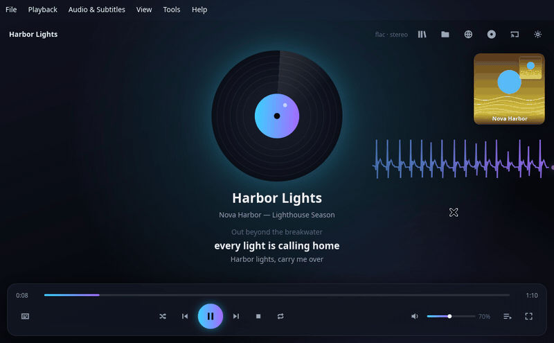
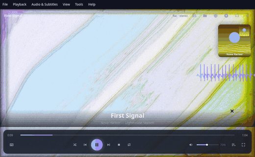
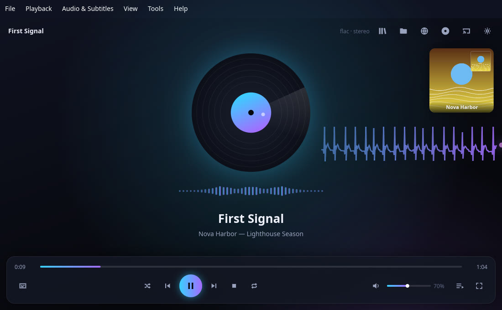
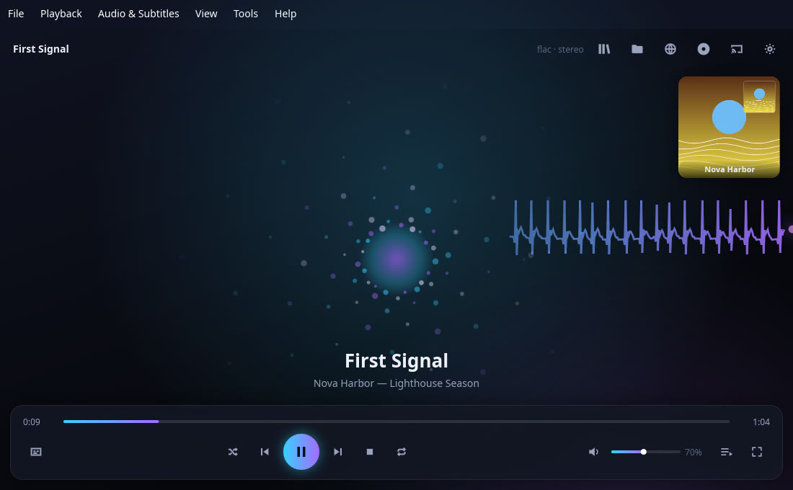
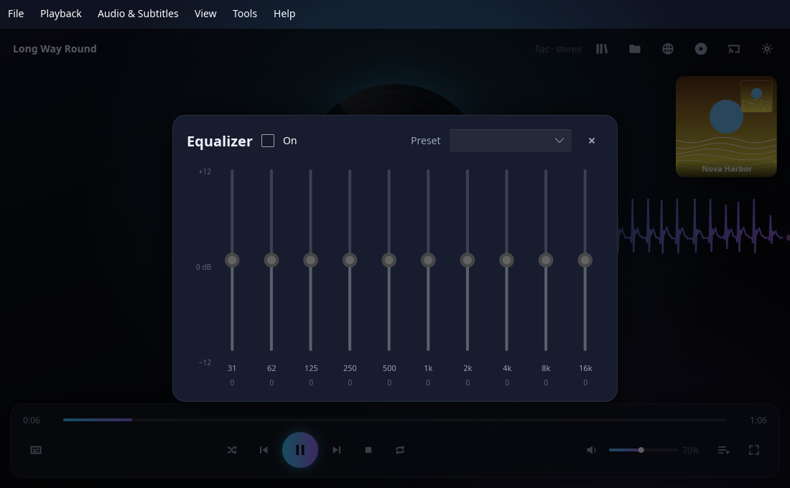
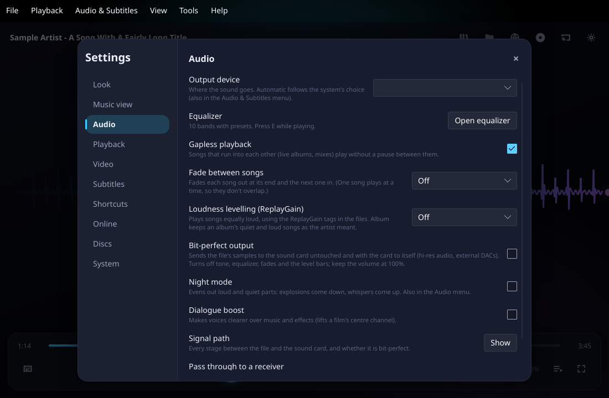
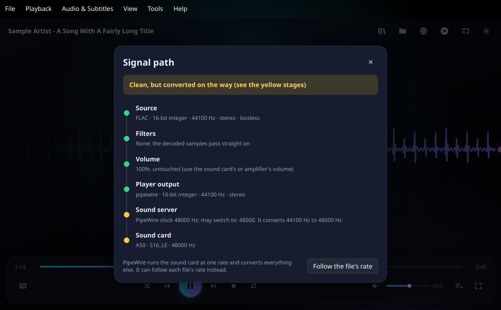

# Music

[← Guide](README.md)

## Lyrics

Timed lyrics scroll under the title. They come from a `.lrc` file beside the song or from
its tags. *Settings → Music view → Look up lyrics online* finds missing ones at LRCLIB.

Press **I** for the whole song: cover, about the artist, and the full lyrics.

## Visuals

*View → Music visualization*: spinning disc, particles, spectrum bars, waveform, stereo
scope, spectrum, spectrogram, or **MilkDrop** with thousands of presets.

| Spinning disc and level bars | Particles |
|---|---|
|  |  |

*View → Pulse line (beat)* turns the heartbeat line on and off.

## Equalizer

Press **E**. Ten bands, with presets such as *Bass boost*, *Vocal* or *Small speakers*.

## Sing along: karaoke

*Audio & Subtitles → Karaoke* takes the singer out of a stereo song (how well depends on
the mix) and shows its timed lyrics large.

## Late at night

- **Night mode** (*Audio & Subtitles*): loud parts come down, quiet parts come up.
- **Dialogue boost**: lifts voices over music and effects in films.

## The best sound

| In *Settings → Audio* | What it does |
|---|---|
| Gapless playback | Live albums and mixes play without pauses |
| Fade between songs | Fades each song out and the next one in |
| Loudness levelling (ReplayGain) | All songs equally loud |
| Bit-perfect output | Sends the file to the sound card untouched, for hi-res music and external DACs |
| Pass through to a receiver | Dolby and DTS undecoded, for an AV receiver |

*Audio & Subtitles → Signal path* shows every stage from the file to the sound card, and
whether it stays bit-perfect. If PipeWire converts the sample rate, one button fixes it.

