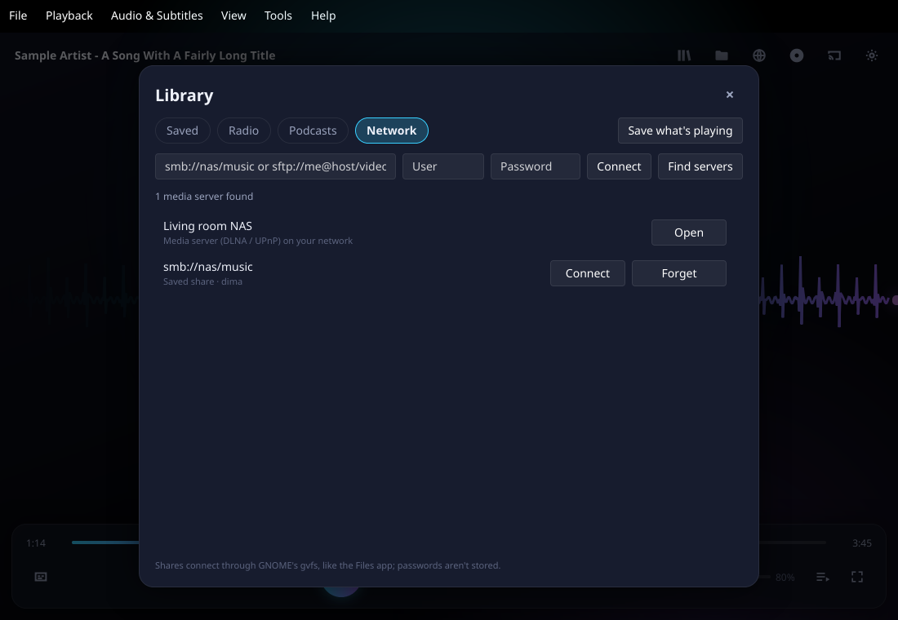

# Network and online video

[← Guide](README.md)

## A media server or NAS (DLNA)

Many NAS boxes, routers and programs (Jellyfin, Plex, MiniDLNA) share media by DLNA.

1. *File → Library → Network (DLNA, SMB, SFTP)…*
2. Servers on your network appear by themselves. **Find servers** looks again.
3. Press **Open** and walk through its folders. Double-click a file to play it.

## A shared folder (Windows, Samba, SSH, WebDAV)

1. In the same panel, type the address:

   | Kind | Example |
   |---|---|
   | Windows or Samba share | `smb://nas/music` |
   | SSH | `sftp://me@myserver/videos` |
   | WebDAV | `davs://cloud.example/files` |

2. Type the user name and password, if it has one, and press **Connect**.
3. Walk through the folders as if they were on your disk.

The password is only used for connecting; the player doesn't keep it. This needs gvfs,
which Ubuntu and most GNOME-based desktops already have.

## YouTube and other sites

1. Copy the page's address in your browser.
2. Press **Ctrl+V** in the player. (Or *File → Open location…*, Ctrl+U.)

This uses [yt-dlp](https://github.com/yt-dlp/yt-dlp), which knows about 1,800 sites. The
packages include it. If it is missing, the player offers to install it. It updates itself
once a week; if a site stops working, use *Tools → Setup & updates → Install / update
yt-dlp*.

Choose the highest quality to use in *Settings → Online*.

### Skip the sponsors

When a YouTube video comes to a sponsor, the player shows a **Skip sponsor** button. The
parts are marked on the seek bar: sponsors and promotion green, the rest blue.
*Settings → Online* can skip them by itself, also skip intros and endings, or turn this
off. Seek back into a part that was skipped to watch it.

This also works for videos you downloaded with yt-dlp, as long as the video's ID is still
in the file's name (`Title [dQw4w9WgXcQ].mkv`) or its link in the tags.

The parts are marked by viewers, through [SponsorBlock](https://sponsor.ajay.app) (data
under CC BY-NC-SA 4.0). The player sends four characters of a code made from the video's
ID, which thousands of videos share, so the service can't tell what you watch.

## Any other stream

Paste its address: `http`, `https`, HLS (`.m3u8`), RTSP and RTMP links all play.
