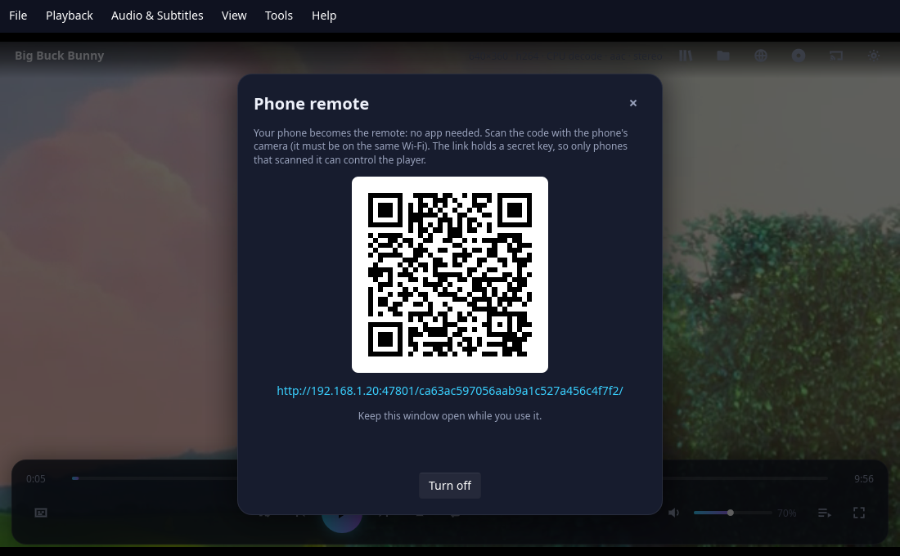
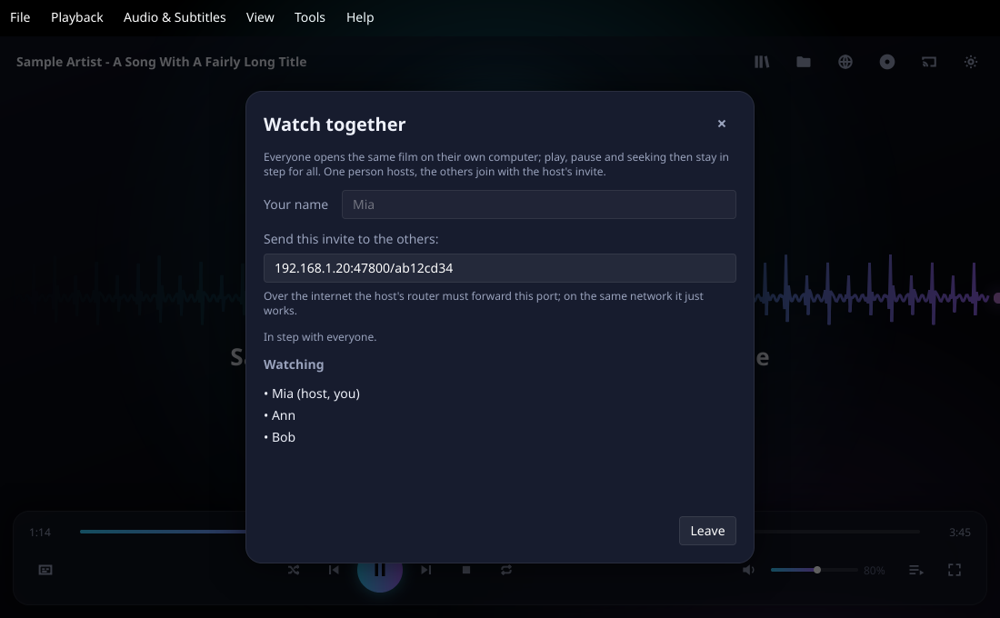

# Phone remote and watching together

[← Guide](README.md)

## Your phone as a remote

No app needed; the phone must be on the same Wi-Fi.

1. *Tools → Phone remote…*, then **Turn on the remote**.
2. Point the phone's camera at the code and open the link.
3. Play, pause, seek, change the volume and the track from the sofa.

The link holds a secret key: only phones that scanned it can control the player. **Turn
off** stops it at once. If the page doesn't open, a firewall may block TCP port 47801.

## Watch together

Each person opens the same film on their own computer; play, pause and seeking stay in
step.

1. One person opens *Tools → Watch together…* and presses **Host**.
2. They send the **invite** to the others.
3. The others paste it and press **Join**.

On the same network this just works. Over the internet, the host's router must forward
TCP port 47800. Only the film's name is shared, never the film.
