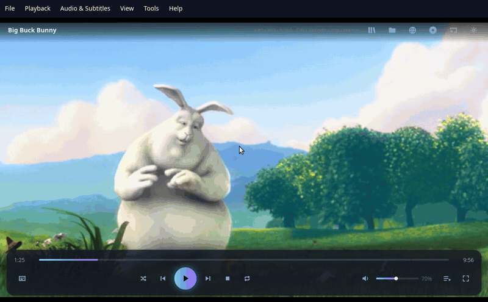
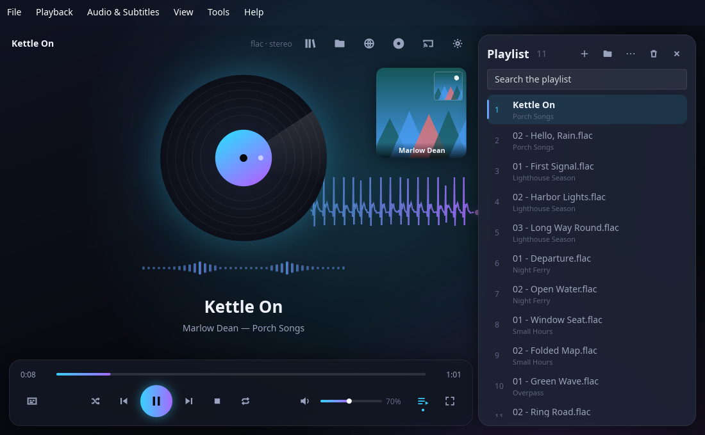
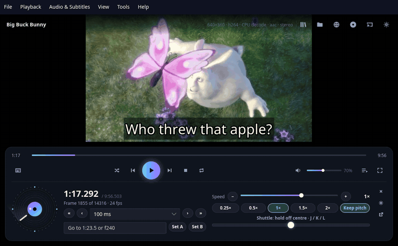
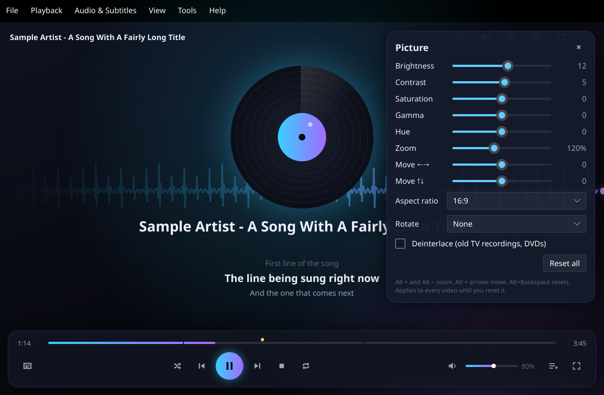

# Playing files

[← Guide](README.md)

## Open files and folders

*File → Open files…* (Ctrl+O) or *File → Open folder…* (Ctrl+Shift+O). A folder is
played with its subfolders, in natural order (track 2 before track 10). Disc images
(`.iso`) and disc folders open as [discs](discs.md).

*File → Open recent* lists what you played lately.

## Jump around

Hover over the seek bar to see a picture of that moment; click to go there.

| To… | Do this |
|---|---|
| Go to an exact time | Ctrl+T, then type e.g. `1:23:45`, `+30` or `50%` |
| Go to another chapter | PgUp / PgDn, or *Playback → Chapters* |
| Remember a moment | Ctrl+B. Bookmarks show as dots on the seek bar and in *Playback → Bookmarks* |
| Repeat a part | Press A at its start, A at its end, and A again to stop |
| Play faster or slower | `]` and `[`, or *Playback → Speed* |
| Skip the pauses in a talk | *Playback → Skip silence* |
| Start over | Home |

**Resume:** videos over 5 minutes, and podcasts or audiobooks over 20, continue where
you stopped. Press Home to start from the beginning.

**Speed:** a file you played faster or slower plays that way the next time, and so do the
files you play right after it from the same folder. *Settings → Playback → Remember the speed* turns
this off.

## Skip silence

For podcasts, lectures and talks: *Playback → Skip silence* shortens every pause to about
half a second. It looks ahead, so the first syllable isn't cut off, and in a video the picture keeps
up. The menu shows how much time it has saved.

- It learns how loud the voice and the room are within a few seconds, so it also works on
  quiet or noisy recordings.
- It is remembered per file, like the speed. Leave it off for music and films: their quiet
  moments count as silence too.
- It needs a file with a length (not live radio), and rests while casting, watching
  together, in Advanced navigation, or with bit-perfect output.

## The playlist

Press **L** to open it. What you open goes into it.

- Double-click an entry to play it.
- Type in the search field to find one.
- The buttons at the top add files or a folder, sort, remove duplicates and clear.
- *File → Playlist file → Save playlist…* (Ctrl+S) saves it as M3U, PLS or XSPF; opening
  such a file plays it.

Shuffle and repeat are buttons in the control bar, and in *Playback → Shuffle & repeat*.

## Fall asleep to it

*Playback → Sleep timer*: stop after 15 minutes to 1½ hours, or at the end of the
current file.

## Frame by frame: Advanced navigation

*Tools → Advanced navigation* (Ctrl+J) opens a panel for exact work: studying a move,
transcribing, finding a cut.

1. Choose a step in the list, from 1 frame to 5 minutes.
2. ← and → move one step (with Shift: ten). Ctrl+← and Ctrl+→ move one frame.
3. Drag the **wheel** on the left to scrub like on an editing deck.
4. Hold the **shuttle** off centre to run forward or back; or use J, K and L.
5. Type a time (`1:23.5`) or a frame (`f240`) to go right there.

Press Ctrl+J again to close it; the arrow keys get their usual job back.

## Delays, aspect ratio, zoom

| Problem | Solution |
|---|---|
| Sound and picture don't match | Ctrl++ and Ctrl+− move the sound by 100 ms |
| Subtitles are early or late | Z and X move them by 100 ms |
| Picture is stretched, or in the wrong place | *View → Picture → Aspect ratio*, or Alt++ and Alt+− to zoom, Alt+arrows to move it |
| Too dark, too pale | *View → Picture → Adjust picture…* |
| Video is sideways | *View → Picture → Rotate* |
| Black bars around the picture | Press C: [Crop black bars](video-and-subtitles.md#crop-black-bars) |
| Combing lines on old TV recordings | *View → Picture → Deinterlace* |

Alt+Backspace resets the picture.

