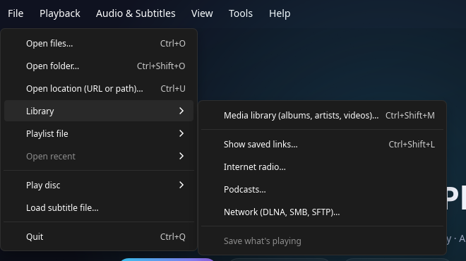
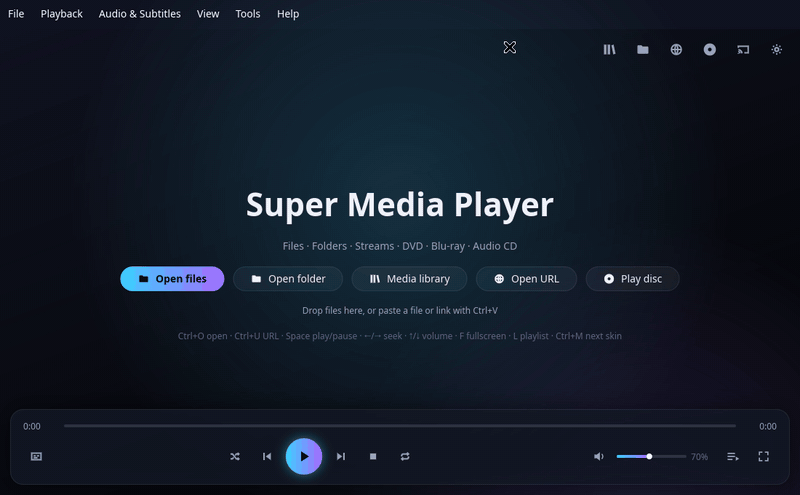
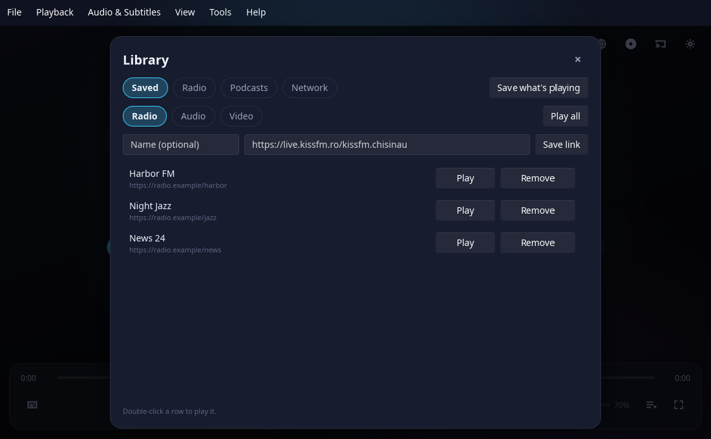
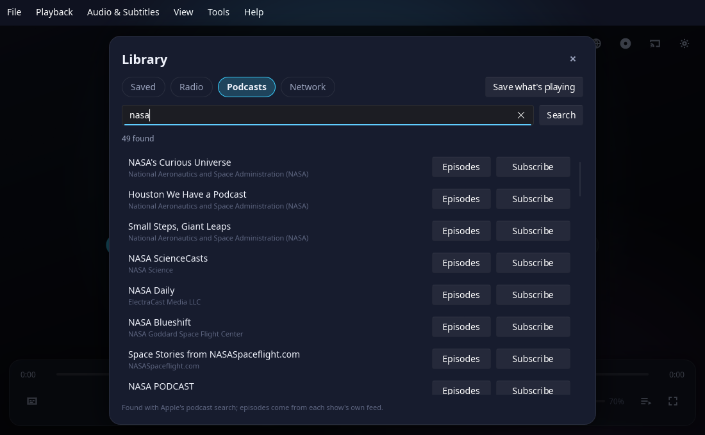

# Radio and podcasts

[← Guide](README.md)

Everything here is in *File → Library*:

## Listen to internet radio

1. Open *File → Library → Internet radio…*
2. Type a station, a genre or a city (`jazz`, `news`, `somafm`) and press Enter. Leave it
   empty to see the most played stations.
3. The small box beside it is the country (`US`, `DE`, `MD`…). Empty it to search
   everywhere.
4. Press **Play**. Press **☆ Save** to keep the station.

The stations come from [radio-browser.info](https://www.radio-browser.info), a free
directory kept by its community, with about 50,000 stations.

## Find your saved stations again

*File → Library → **Show saved links…***, or **Ctrl+Shift+L**. They are sorted into Radio,
Audio and Video; double-click one to play it, or press **Play all**.

To save something else:

- **What is playing now:** *File → Library → Save what's playing*.
- **A link you have:** paste it in the saved links panel, give it a name, and press
  **Save link**.

## Record the radio

While a station plays: *Tools → Record this stream*. Choose it again to stop. The
recording goes to your Videos folder, in its original quality.

## Podcasts

1. *File → Library → Podcasts…*
2. Type a name or subject and press Enter.
3. **Episodes** lists a show's episodes; double-click one to play it.
4. **Subscribe** keeps the show in this list.

Long episodes continue where you stopped. Use `]` to listen faster; voices keep their
pitch. *Playback → Skip silence* shortens the [pauses](playing.md#skip-silence). Both are
remembered for the show: its next episode, opened from here, starts the same way.
