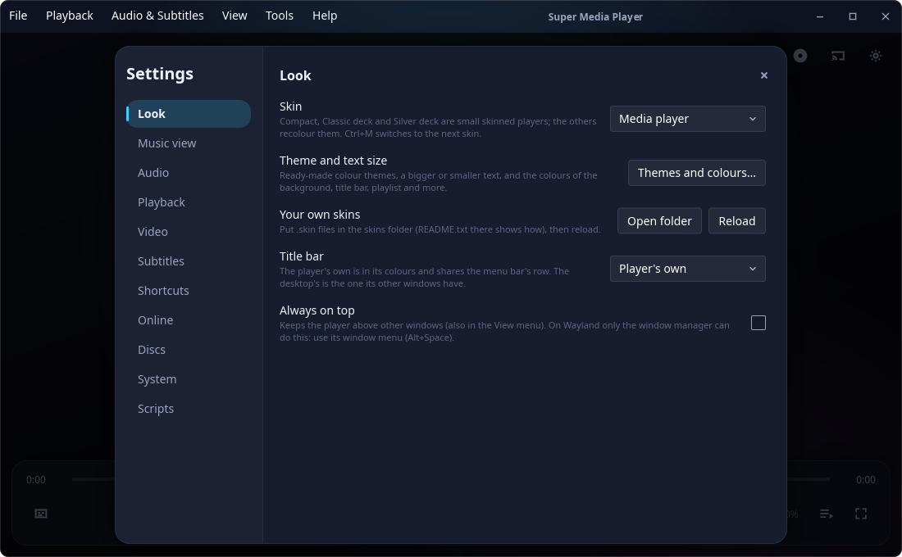
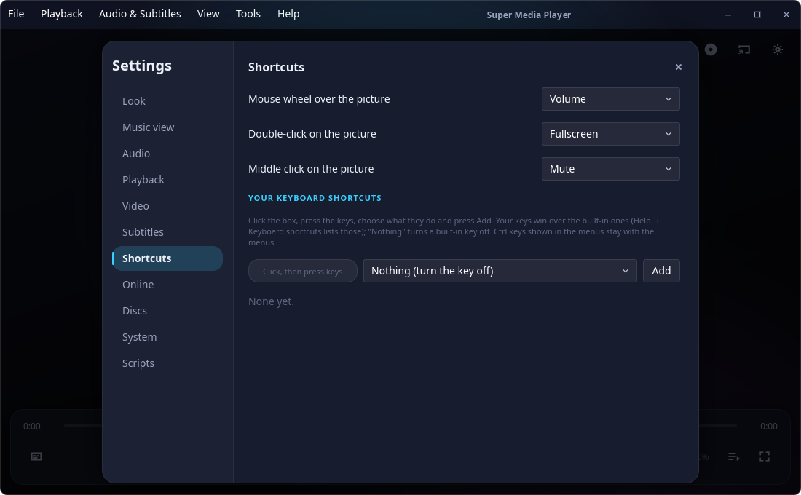
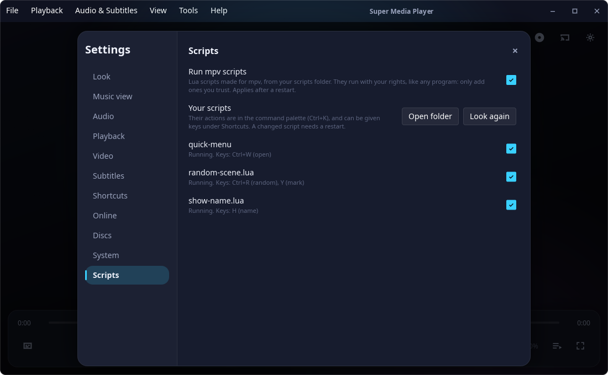

# Settings

[← Guide](README.md)

Open them with the gear at the top right, or **Ctrl+P**. Changes apply at once, unless it
says otherwise.

| Page | What is there |
|---|---|
| Look | Skin, colours, your own skins, title bar, always on top |
| Music view | Visuals, pulse line, artist picture, lyrics |
| Audio | Output device, equalizer, gapless, ReplayGain, bit-perfect, night mode |
| Playback | Resume, remembering the speed, series intros, next episode, preview pictures, speech model |
| Video | Hardware decoding, enhancement, smooth motion, black bars, HDR |
| Subtitles | Their look, and the OpenSubtitles account |
| Shortcuts | Your own keys and mouse actions |
| Online | Streaming quality, sponsors in YouTube videos, yt-dlp, updates |
| Discs | DVD menus, CD names, Blu-ray decryption |
| System | FFmpeg updates, system check, window system, one player window |
| Scripts | Your own mpv scripts |

## Your own shortcuts

*Settings → Shortcuts*: click the box, press the keys, choose what they should do, and
press **Add**. "Nothing" turns a built-in key off.

## mpv scripts

The player runs Lua scripts made for [mpv](https://mpv.io), from your own folder. Scripts
run with your rights, like any program: only add ones you trust.

1. *Settings → Scripts → Open folder* opens `~/.config/super-media-player/scripts`.
2. Put the script there: a `.lua` file, or a folder with a `main.lua` in it.
3. Press **Look again**. The list shows whether it runs, its keys, or why it stopped.

- **Options** of a script go in the `script-opts` folder next to `scripts`, as
  `script-opts/name.conf`. `script-modules` and `fonts` work too. An `mpv.conf` or
  `input.conf` isn't read.
- **Keys:** a script can use any key the player doesn't. What it put on a key of the
  player's is in the command palette (**Ctrl+K**), and *Settings → Shortcuts* can give it
  another key. While a script's own menu is open, its keys come first.
- **Switching one off**, or changing one that runs, takes effect after a restart.
- What a script shows is drawn on the picture, so you don't see it while music plays.
  Mouse buttons don't reach scripts, and scripts that replace mpv's on-screen controls
  aren't meant for this player.

## Keyboard shortcuts

| Key | Action |
|---|---|
| Space / K | Play / pause |
| ← / → | Back / forward 5 s (Shift: 30 s) |
| ↑ / ↓ | Volume |
| M | Mute |
| N / P | Next / previous |
| F, F11, double-click | Fullscreen (Esc leaves) |
| L | Playlist |
| I | Song information and lyrics (music) |
| E | Equalizer |
| A | A-B repeat: mark A, mark B, off |
| [ / ] | Slower / faster |
| . / , | Next / previous frame |
| Home | Start over |
| PgUp / PgDn | Previous / next chapter |
| S | Screenshot |
| Z / X | Subtitles 100 ms earlier / later |
| Ctrl+− / Ctrl++ | Sound 100 ms earlier / later |
| Alt+− / Alt++, Alt+arrows | Zoom and move the picture (Alt+Backspace resets) |
| Ctrl+O / Ctrl+Shift+O | Open files / a folder |
| Ctrl+U, Ctrl+V | Open a link; play what you copied |
| Ctrl+D | Play the disc in the drive |
| Ctrl+Shift+D | The DVD's menu |
| Arrows, Enter | Choose in a DVD's menu |
| Ctrl+Shift+M | Media library |
| Ctrl+Shift+L | Show saved links (radio stations) |
| Ctrl+T | Jump to a time |
| Ctrl+B | Bookmark this moment |
| Ctrl+S | Save the playlist |
| Ctrl+J | Advanced navigation |
| Ctrl+I | Media information |
| Ctrl+M | Next skin |
| Ctrl+K | Command palette |
| Ctrl+P | Settings |
| Ctrl+Q | Quit |
| F1 | About |

*Help → Keyboard shortcuts* shows them in the player.

## What goes online

The player has no account and collects nothing. These features contact a service, and
only when you use them or leave them on:

| Feature | Contacts | Sends | Turn it off in |
|---|---|---|---|
| Artist pictures and information | Deezer, Wikipedia | artist and album names | Settings → Music view |
| Lyrics | LRCLIB | artist, title, album, length | Settings → Music view |
| CD names and covers | MusicBrainz, Cover Art Archive | the CD's track layout | Settings → Discs |
| Radio search | radio-browser.info | your search | – |
| Podcast search | Apple | your search | – |
| Subtitle search | OpenSubtitles | the film's fingerprint, or the name you type | – |
| Skipping sponsors | SponsorBlock | four characters of a code made from the YouTube video's ID | Settings → Online |
| yt-dlp and key database updates | GitHub and the database's site | nothing about you | Settings → Online |
