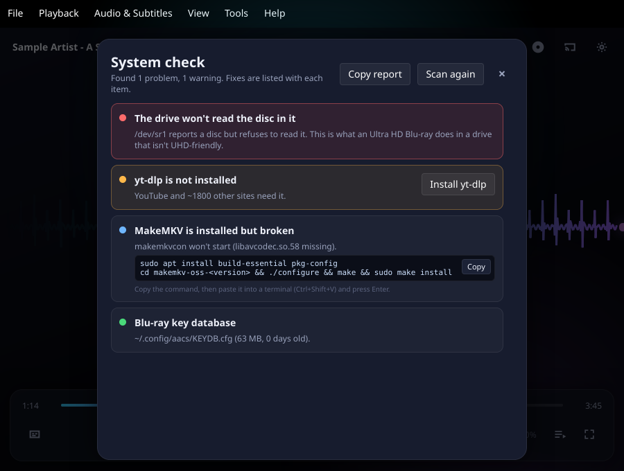

# Troubleshooting

[← Guide](README.md)

## First: the system check

*Tools → Setup & updates → System check…* looks for missing libraries, a broken MakeMKV,
an old key database, and drives that can't read their disc. Each finding says how to fix
it, often with a button or a command to copy.

## Common problems

| Problem | Try |
|---|---|
| No sound | *Audio & Subtitles → Output device*; check the volume and that it isn't muted (M). With *Bit-perfect output* on, other programs can't use the card |
| Video shows glitches or is black | Turn off *Settings → Video → Hardware video decoding* |
| Dragging files doesn't work | *Settings → System → Window system → X11 (drag and drop)*, then restart. Or copy the file and press Ctrl+V |
| A file stays at "Opening…" or never starts, and you use scripts | A script may be stuck: switch it off in *Settings → Scripts*, then restart |
| The window looks blurry on a scaled screen | Set the same option to *Wayland* |
| YouTube stopped working | *Tools → Setup & updates → Install / update yt-dlp* |
| A radio station doesn't start | Stations come and go: search for another entry of the same station |
| "Nothing found" when searching radio | The country box is set: empty it |
| A DVD doesn't play | *Tools → Setup & updates → System check*: DVD decryption (libdvdcss) must be there |
| A DVD's menu misbehaves | Press **Main film**, or turn off *Settings → Discs → DVD menus* |
| A Blu-ray doesn't play | Download the key database again; or use [MakeMKV](discs.md#ultra-hd-blu-ray-and-discs-that-wont-play-makemkv) |
| "The drive sees a disc but refuses to read it" | Usually a 4K disc: see the same section |
| The TV isn't found, or nothing plays on it | See [Casting](casting.md#if-it-doesnt-work) |
| No MilkDrop, no subtitles from speech | Their optional helpers aren't installed; the panel or the [build notes](../BUILDING.md) say how |

## Where things are kept

| | |
|---|---|
| Settings, skins, saved links | `~/.config/super-media-player/` |
| Library, positions, downloaded helpers | `~/.local/share/super-media-player/` |
| Covers, lyrics and other caches (safe to delete) | `~/.cache/super-media-player/` |
