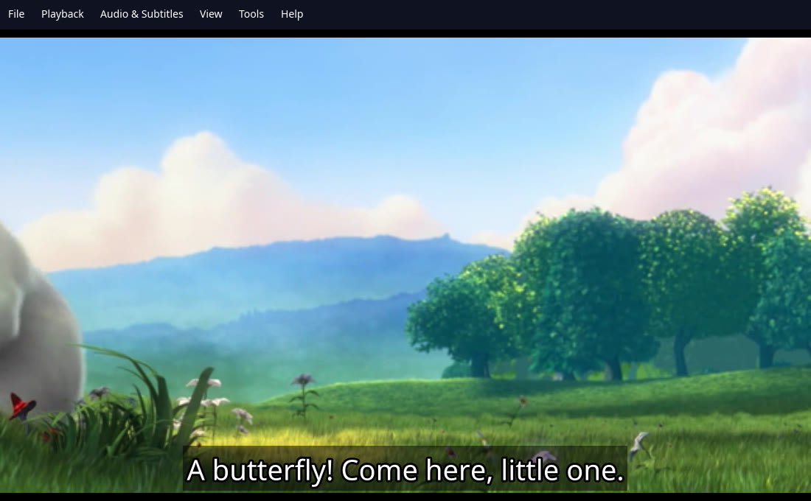
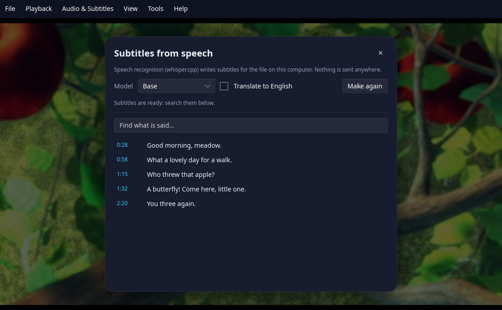
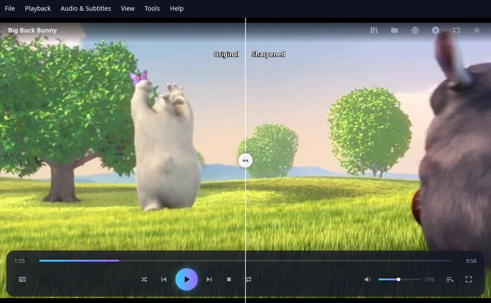
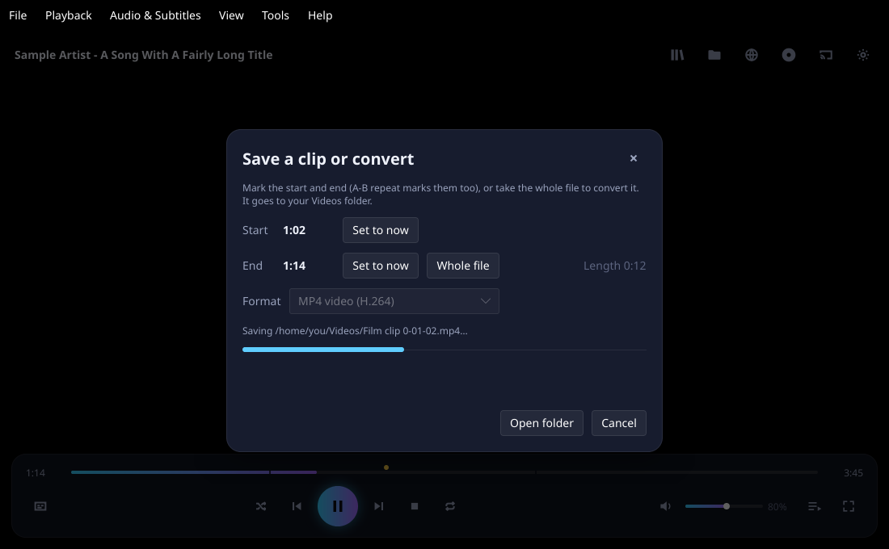

# Video and subtitles

[← Guide](README.md)

## Subtitles

- **From a file:** a subtitle file with the film's name in the same folder loads by itself.
  Others: *File → Load subtitle file…*
- **Choose or turn off:** the button at the far left of the control bar, or *Audio &
  Subtitles → Subtitles*.
- **Early or late:** Z and X, 100 ms at a time, or let the player do it (below).
- **Size, colour, position:** *Settings → Subtitles*.

### Find subtitles online

*Audio & Subtitles → Subtitles → Find subtitles online…* searches OpenSubtitles, by the
film itself where possible, so they fit. It needs your own free API key from
[opensubtitles.com](https://www.opensubtitles.com); enter it once in *Settings →
Subtitles*.

Downloaded subtitles that weren't made for this very file are lined up with the speech by
themselves. *Settings → Subtitles* turns that off.

### Line subtitles up with the speech

Subtitles from a file that come too early or too late, or drift away during the film:

1. Turn them on.
2. *Audio & Subtitles → Subtitles → Line up with the speech…* The player listens to the
   film for a few seconds and moves the lines to where somebody speaks, in any language. It
   also corrects a wrong frame rate and scenes that were cut.
3. **Undo**, or **Save in the file** to keep it for next time. The original stays next to it,
   ending in `.orig`.

If the subtitles don't clearly match (another episode, say), nothing is changed. This works
for SRT, WebVTT and ASS files with films on your computer, not for subtitles built into a
film.

### Make subtitles from speech

No subtitles anywhere? The player can write them, on your computer; nothing is sent.

1. *Audio & Subtitles → Subtitles → Subtitles from speech, and search…*
2. Choose a model (bigger is better and slower; it is downloaded once) and, if you like,
   *Translate to English*.
3. Start it. The subtitles load when they're done.

This needs whisper.cpp's `whisper-cli`; if it is missing, the panel says how to get it.

### Find what was said

The same panel searches any subtitles: type a word, click a line, and the film jumps
there.

## Skip intros and credits

In a folder of episodes the player finds the shared intro and credits by listening, and
shows a **Skip intro** button. During the credits it offers the next episode. *Settings →
Playback* can skip by itself, or turn this off.

Opening one episode queues the next ones.

## A sharper picture

*View → Video enhancement*: **Sharpen**, **Upscale (AMD FSR)** for low resolutions, or
**Anime (Anime4K)**. *Compare before / after* shows both with a line you can drag:

*View → Smooth motion* evens out camera pans. *View → HDR tone-mapping* sets how HDR
films are fitted to your screen.

## Crop black bars

Press **C** (*View → Picture → Crop black bars*) when black bars are part of the video, and
the picture itself fits the window. It stays on for every video, until you press C again.

- Every part that ever shows a picture is kept: a film that fills the screen for some
  scenes isn't cut there.
- A file is looked through once, in a few seconds. Discs and streams are watched as they
  play, so the bars go after about ten seconds of picture. They come back if a later scene
  needs the room.
- It doesn't change the file, and rests in DVD menus.

## Save a clip or convert

1. *Tools → Save a clip or convert…*
2. Mark **Start** and **End** (or press **Whole file**).
3. Choose the format: MP4, GIF, MP3, FLAC or Opus.
4. Save. It goes to your Videos folder.

**S** saves a screenshot.
